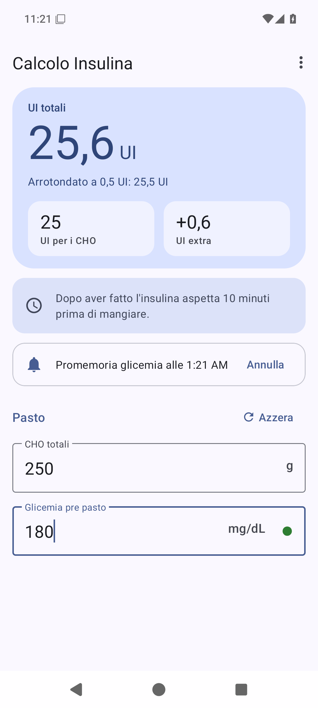
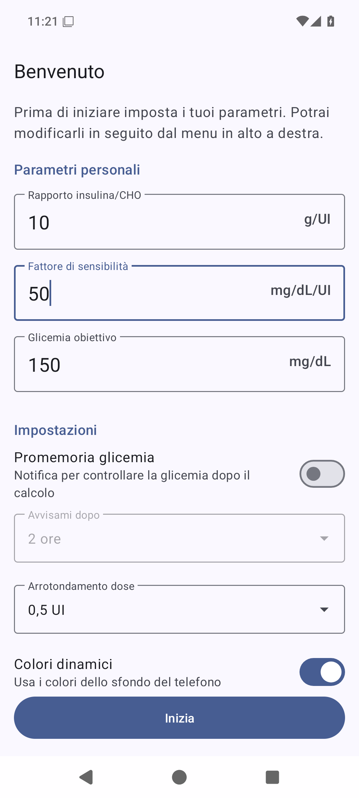
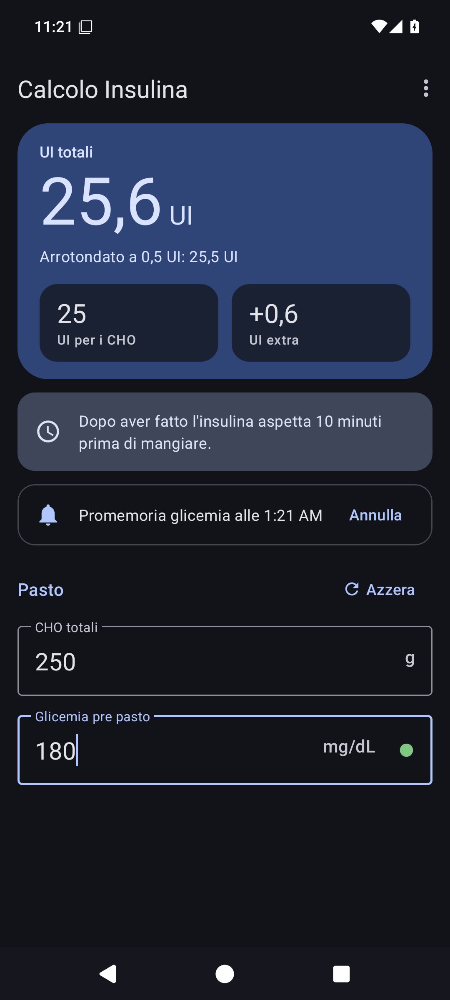
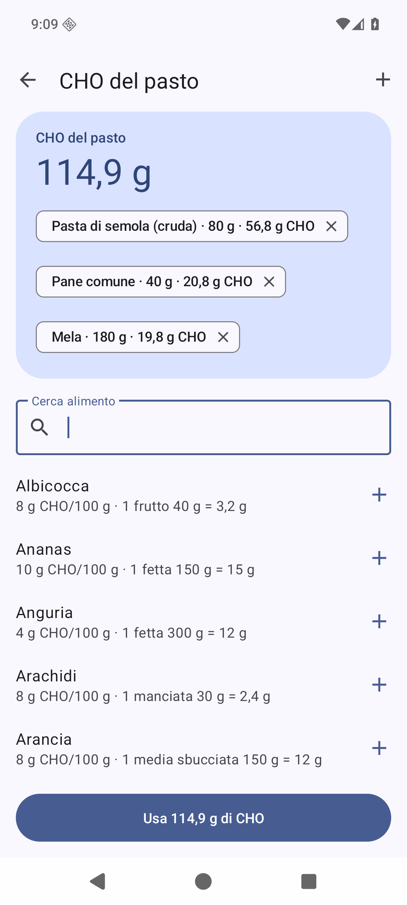

# Calcolo Insulina

App Android per calcolare il bolo di insulina del pasto e la correzione in base alla glicemia, con interfaccia Material 3.

<p align="center">
  
  
  
</p>

## Download

Scarica l'ultimo `CalcoloInsulina.apk` dalla pagina [Releases](https://github.com/Alfree125/calcolo-insulina/releases/latest) e aprilo sul telefono. Android ti chiederà di consentire l'installazione da fonti sconosciute.

Supporta da **Android 6.0** (API 23) ad **Android 17** (API 37).

> **Se hai installato la versione 2.0**, disinstallala prima di installare la 2.0.1 o successive: dalla 2.0.1 l'app è firmata con una chiave diversa e Android non permette l'aggiornamento diretto. Dovrai reinserire i parametri personali.

Al primo avvio l'app chiede i parametri personali. Se attivi il promemoria, su Android 13 e successivi ti chiede anche il permesso per le notifiche.

## Come calcola

Le formule sono quelle del foglio di calcolo da cui è nata l'app:

| Valore | Formula |
| --- | --- |
| UI per i CHO | CHO totali ÷ rapporto insulina/CHO |
| UI extra | (glicemia pre pasto − glicemia obiettivo) ÷ fattore di sensibilità |
| **UI totali** | UI per i CHO + UI extra |

Esempio: 250 g di CHO, glicemia 180 mg/dL, rapporto 10 g/UI, fattore 50 mg/dL/UI, obiettivo 150 mg/dL → 25 + 0,6 = **25,6 UI**.

La correzione può essere negativa quando la glicemia è sotto l'obiettivo: in quel caso riduce la dose del pasto. Se il totale scende sotto zero l'app mostra 0.

## Funzioni

- Calcolo in tempo reale mentre scrivi, con risultato sempre visibile in alto.
- Promemoria di attendere 10 minuti tra l'insulina e il pasto.
- Configurazione dei parametri personali al primo avvio; dopo si modificano dal menu ⋮.
- Promemoria opzionale con notifica per controllare la glicemia dopo il calcolo (2 ore di default, da 30 minuti a 4 ore).
- Arrotondamento della dose a 0,5 UI, 1 UI o nessuno.
- Indicatore colorato dello stato della glicemia (tocca il pallino per i dettagli).
- Tema chiaro e scuro, colori dinamici su Android 12+.
- Layout a due colonne su tablet, pieghevoli e in orizzontale.

## Beta: CHO del pasto dal database alimenti

<p align="center"></p>

Nelle versioni beta (`2.1.0-beta.x`, pagina [Releases](https://github.com/Alfree125/calcolo-insulina/releases)) l'icona con coltello e forchetta nel campo CHO apre il calcolo dei carboidrati del pasto. Funziona tutto sul telefono, senza Internet: l'app non ha il permesso di accesso alla rete.

- Cerca un alimento (anche per sinonimo: "spaghetti" trova la pasta) e inserisci i grammi, oppure tocca la porzione tipica.
- Aggiungi più alimenti: l'app somma i CHO e con **Usa** li inserisce nel campo CHO.
- Il database locale (SQLite) contiene circa 120 alimenti comuni italiani, con i carboidrati per 100 g e una porzione tipica ([elenco](app/src/main/res/raw/alimenti.csv)).
- Con **Nuovo alimento** aggiungi i tuoi prodotti copiando i carboidrati per 100 g dall'etichetta. Tienili premuti nell'elenco per modificarli o eliminarli.
- Gli alimenti che usi più spesso salgono in cima all'elenco.
- **Modalità sviluppatore** (Impostazioni, sperimentale): registri le dosi fatte e il calcolo sottrae l'insulina ancora attiva, stimata con la curva di OpenAPS e la durata d'azione che scegli.

> I valori del database sono medie indicative: per i prodotti confezionati fa fede l'etichetta. Pesa gli alimenti quando puoi.

## Compilare dai sorgenti

Servono JDK 17 e l'Android SDK con la piattaforma `android-37.0`.

```bash
./gradlew assembleRelease
```

L'APK viene generato in `app/build/outputs/apk/release/`.

La chiave di firma non è nel repository. La build la legge da `~/android-keys/calcolo-insulina.properties` (con `storeFile`, `storePassword`, `keyAlias`, `keyPassword`). Puoi indicare un altro file con `-PfirmaRelease=percorso` o con la variabile d'ambiente `CALCOLO_INSULINA_FIRMA`. Se il file non c'è, l'APK viene firmato con la chiave debug locale e non si potrà installare sopra le release ufficiali.

## Avvertenza

Questa app è uno strumento di supporto al calcolo e non sostituisce il parere medico. Controlla sempre la dose e segui le indicazioni del tuo diabetologo. I parametri personali (rapporto insulina/CHO, fattore di sensibilità, glicemia obiettivo) devono essere stabiliti con il tuo medico.

## Licenza

Distribuita con licenza [GNU GPL v3.0](LICENSE).
